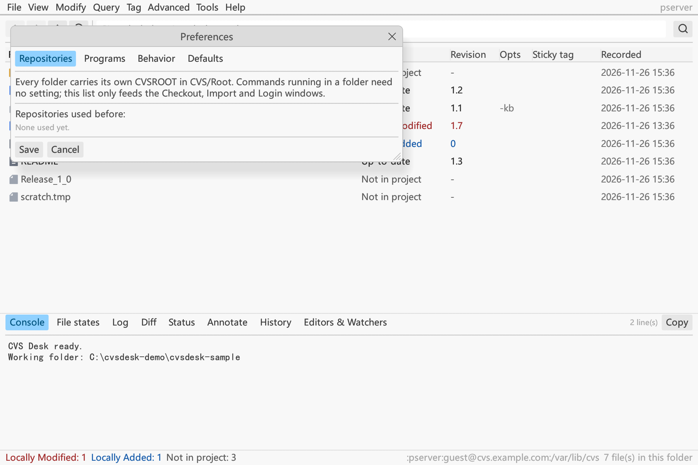

<p align="center">
  
</p>

# CVS Desk

[](https://github.com/woolsen/cvs-desk/actions/workflows/ci.yml)
[](https://github.com/woolsen/cvs-desk/releases/latest)

CVS Desk is a Windows desktop front end for CVS, written in Rust with egui. It ships with its
own CVS client, so the desktop program does not need an external `cvs.exe`.


## Download

Prebuilt binaries for Windows 10 and 11 are on the
[releases page](https://github.com/woolsen/cvs-desk/releases/latest). Download the
`windows-x64.zip`, extract it anywhere, and run `cvsdesk.exe`. The `cvs.exe` beside it is the
standalone command-line client. The zip also contains `LICENSE` and `third-party-licenses.txt`,
the full license texts for CVS Desk and its dependencies.

The build is not code-signed yet, so Windows SmartScreen may warn about it. Each release
includes `SHA256SUMS.txt` for checking the download.

## Graphics

The window draws through OpenGL. That keeps the program small: on an Intel integrated GPU
the same window needs about 73 MB of private memory this way, against 355 MB when it is
drawn through DX12.

A remote desktop session or a virtual machine may offer no usable OpenGL, and then the
window cannot open. Name another backend before starting the program:

```text
set WGPU_BACKEND=vulkan
cvsdesk.exe
```

`WGPU_BACKEND=dx12` does the same on a machine whose Vulkan driver is missing.

## Features

- Folder tree and file list with per-file state: modified, added, missing, unmodified, and more.
- Update, commit, diff, log, status, annotate, history, tag, and branch operations.
- Revision graph and tag browser.
- Checkout, import, release, and repository browsing.
- Built-in `cvs` client with `:pserver:` and `:ext:` support, `.cvspass`, `~/.cvsrc`, and
  Gzip-stream compression.
- Reads GBK and UTF-8 control files, so Chinese file names work.
- Works without a server by opening a generated sample working copy.

| Revision graph | Preferences |
|---|---|
|  |  |

## Build

Building needs Rust stable with the MSVC toolchain:

```text
cargo build --release
```

This produces `cvsdesk.exe` and `cvs.exe` in `target\release`.

```text
cargo run --release
```

With no folder argument and no previous folder, the program opens a generated sample working
copy. Pass a folder to open it directly:

```text
cargo run --release -- C:\work\my-project
```

Settings are stored in `cvsdesk-settings.toml` next to the executable.

## Test

```text
cargo test
```

The client test runs the real `cvs.exe` against an in-process pserver, so it needs no network
or account. See `tests/README.md` for the optional test against a real working copy.

## Contributing

See `.github/CONTRIBUTING.md`. Bug reports and feature requests are welcome. Code contributions require
a signed contributor license agreement so the project can also be offered under different
commercial terms.

## License

CVS Desk is licensed under the GNU Affero General Public License, version 3 only
(`AGPL-3.0-only`). See `LICENSE` for the full text.

Third-party dependencies are listed in `Cargo.lock`; they are mostly MIT or Apache-2.0, with
`encoding_rs` also under BSD-3-Clause. The file-type icons come from Remix Icon
(Apache-2.0). Each component keeps its own license.

Commercial licensing for terms other than AGPL-3.0, and commercial support, are available
separately: `woolsen@qq.com`.
