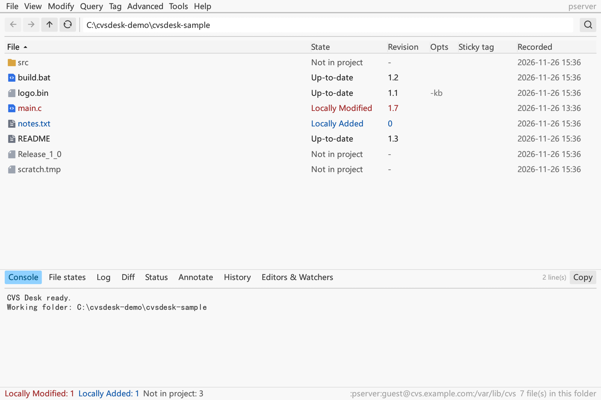
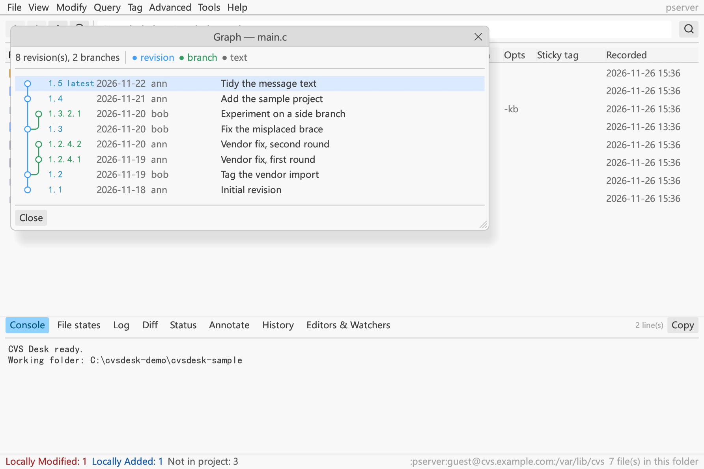

# CVS Desk

[](https://github.com/woolsen/cvs-desk/actions/workflows/ci.yml)

CVS Desk is a Windows desktop front end for CVS, written in Rust with egui. It ships with its
own CVS client, so the desktop program does not need an external `cvs.exe`.



## Features

- Folder tree and file list with per-file state: modified, added, missing, unmodified, and more.
- Update, commit, diff, log, status, annotate, history, tag, and branch operations.
- Revision graph and tag browser.
- Checkout, import, release, and repository browsing.
- Built-in `cvs` client with `:pserver:` and `:ext:` support, `.cvspass`, the Windows CVSNT
  password store, `~/.cvsrc`, and `Gzip-stream` compression.
- Reads GBK and UTF-8 control files, so Chinese file names work.
- Works without a server by opening a generated sample working copy.

| Revision graph | Preferences |
|---|---|
|  |  |

## Requirements

- Windows 10 or 11
- Rust stable with the MSVC toolchain
- A CVS server for network operations

## Build

```text
cargo build --release
```

This produces two programs in `target\release`:

| Program | Purpose |
|---|---|
| `cvsdesk.exe` | The desktop application. |
| `cvs.exe` | A standalone CVS client. Put it on `PATH` if you want to run it from a console. |

## Run

```text
cargo run --release
```

The program remembers the last folder it opened. With no folder argument and no previous
folder, it creates a sample working copy under the system temp folder. You can also pass a
folder directly:

```text
cargo run --release -- C:\work\my-project
```

Settings are stored in `cvsdesk-settings.toml` next to the executable.

## Test

```text
cargo test
cargo test --test cvs_client
```

The client test runs the real `cvs.exe` against an in-process pserver, so it needs no network
and no account.

The optional test against a real working copy is read-only and never runs `cvs`:

```text
set CVSDESK_REAL_FOLDER=C:\work\my-project
cargo test --test real_folder -- --ignored --nocapture
```

See `tests/README.md` for details.

## Layout

```text
src/core/     rules: control-file decoding, file states, settings, revision graph
src/client/   protocol and working-copy implementation used by the cvs program
src/app/      egui window, dialogs, and actions
tests/        integration tests
tools/        development helpers (the GBK table generator)
```

Rules belong in `src/core/` with tests beside them. The window is a thin layer over the
library, so it can be tested without opening a window.

## Contributing

See `CONTRIBUTING.md`. Bug reports and feature requests are welcome. Code contributions
require a signed contributor license agreement so the project can also be offered under
different commercial terms.

## License

CVS Desk is licensed under the GNU Affero General Public License, version 3 only
(`AGPL-3.0-only`). See `LICENSE` for the full text.

Commercial licensing for terms other than AGPL-3.0, and commercial support, are available
separately: `woolsen@qq.com`.
